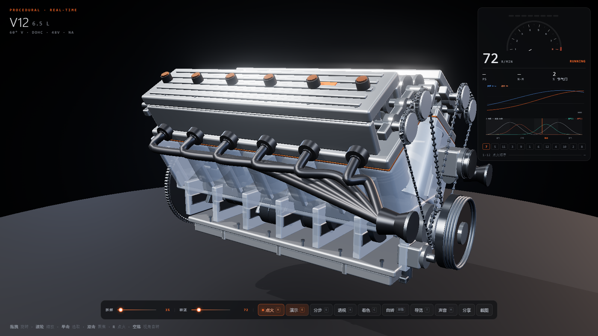
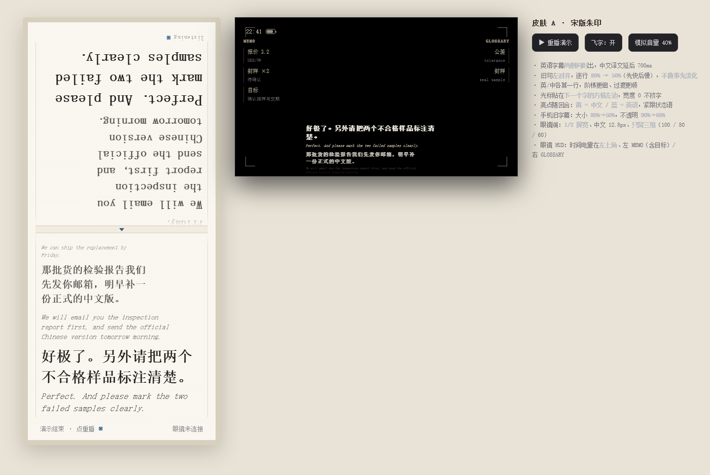

# 李学宇 · Yancy

广东工业大学 · 工业软件多专业融合班（2026 年转入）

---

这里放的不是一堆"我会什么"的清单，而是四件东西。它们看起来分属四个专业方向 ——
可视化、仿真、硬件、界面 —— 但底下是同一件事：

> **让设计数据自己证明自己是对的。**

不是"我画过一张板、建过一个模、做过一套界面"，
是"我能给出证据说明这张板、这个模、这套界面和我以为的一致"。

| | 仓 | 一句话 | 它自己的证据 |
|---|---|---|---|
| 几何 | [`v12-engine`](https://github.com/GITHUB_USER/v12-engine) | 6.5 L 60° V12 发动机的浏览器数字样机，单文件 | 29 个零件全部按曲轴角逐帧解算；活塞位移用真实曲柄连杆几何，不是正弦近似 |
| 仿真 | [`arm-mujoco-sim`](https://github.com/GITHUB_USER/arm-mujoco-sim) | 七轴舵机机械臂的参数化 MJCF 生成器 | 改一个参数文件，XML、关节限位、几何体、自检报告全部重出 |
| 硬件 | [`hw-designs`](https://github.com/GITHUB_USER/hw-designs) | 三档酒精检测板 + STS3215 关节件 | 从 Gerber 反画出预览图；摆件意图 ↔ 飞针测试坐标，28/30 偏差 < 0.001 mm |
| 界面 | [`ar-subtitle-ui`](https://github.com/GITHUB_USER/ar-subtitle-ui) | 面对面同传的 14 套界面，单文件零依赖 | 字号/块宽/延迟全部从 558 px 半屏算术推出；14 页排版体检 0 / 14 有问题 |

一条线读下来是：**几何建模 → 仿真验证 → 硬件落地 → 工具链自动化**。

---

## 总览

| 几何（`v12-engine`） | 仿真（`arm-mujoco-sim`） |
|---|---|
|  |  |
| **硬件（`hw-designs`）** | **界面（`ar-subtitle-ui`）** |
|  |  |

---

## 一、几何：数字是法律 · `v12-engine`


一台 6.5 L、60° V12 自然吸气发动机（DOHC、48 气门），在浏览器里实时运转、可拆解。

**约束先立。** 动手前先把真机数字钉死，`1 scene unit = 1 cm`，曲轴中心为原点：

| 项 | 真机 | 模型单位 |
|---|---|---|
| 缸径 × 行程 | 95 × 76.4 mm | 9.5 × 7.64 |
| 曲轴回转半径 | 38.2 mm | 3.82 |
| 连杆中心距 | 145 mm | 14.5 |
| 缸心距 | 102 mm | 10.2 |
| V 角 | 60° | 右列 +30° / 左列 −30° |

钉住单位之后，"看起来像"就不再是标准了。活塞位置必须按曲柄连杆几何解：

$$s(\theta) = r\cos\delta + \sqrt{L^2 - r^2\sin^2\delta},\qquad \delta = \theta + i\cdot 60° - 30°\sigma$$

而不是拿一条正弦波凑个差不多 —— 因为正弦近似在上下止点附近的误差肉眼可见，
一旦相机推近看单缸四冲程，那个误差就露馅。

**做法。** 29 个可交互零件、139 个 mesh、约 29.8 万三角面，全部由代码生成形状，
没有任何模型文件、贴图、HDRI 或音频采样。发动机的声音也是代码合成的：
点火顺序决定脉冲间隔，转速决定基频，拉到 8300 r/min 时听感会跟着变调。

性能靠结构解决而不是靠减面：48 个气门、48 个弹簧、48 个挺柱各用 4 组 `InstancedMesh`
（进/排 × 左右列），98 颗螺栓共用 1 个实例模板，每帧只更新实例矩阵、不重建几何。

**能验的东西。** 转速滑块 30~8300 对数映射，压到 60 r/min 就能逐帧看清单缸四冲程的每一冲；
爆炸拆解 0–100% 六层延迟错峰；分步拆解 7 步（盖板 → 正时链 → 4 凸轮轴 → 气门组 → 缸盖 → 活塞连杆 → 曲轴）。
控制台报错 0。

**[▶ 在线预览](https://wbapp-0h1wigjufzkz7jzgnjiu93.app.workbuddy.host/?sharecode=5ACYGHLV2H)**

---

## 二、仿真：一个数字只有一个来源 · `arm-mujoco-sim`

一张手写的 MJCF 不难。难的是**第二次改**。

那台机械臂每个关节处不是"细杆加个球"，而是一整颗舵机：舵机朝向决定关节轴方向，
关节轴方向决定铝杆往哪伸，铝杆长度决定下一个舵机放哪。改一个尺寸，
后面 6 个 body 的 `pos` 全要跟着重算。第一版是手写的，改到第三个关节就放弃了 ——
因为**改错了看不出来**，MuJoCo 不会报错，它只会安静地渲染出一个差 20 mm 但看着挺像的模型。

所以改成生成器，分层只有一条规则：

```
arm_params.py     ← 人改这里（唯一的数字来源）
      ↓
build_mjcf.py     ← 只写逻辑：向量→关节链、2mm 板厚→胶囊半径、面朝向→盒尺寸
      ↓
arm_real.xml      ← 产物，不手改（改了下一次生成就被覆盖）
```

**它自己会核对。** 跑一条命令，生成完直接打一张表，把"我填的值"和"实际生效的值"并排：

```console
$ python build_mjcf.py
已生成 arm_real.xml  (9.0 KB)
自检：nbody=11  nq=7  nu=7  ngeom=28
  L2_upper_b         10mm      9mm     20mm   << L 太短(r 被夹到 0.45L)
```

`<< L 太短` 这一行是这个项目里最贵的一个 bug：胶囊半径不能超过杆长的一半，
否则相邻两段的胶囊会穿模，而穿模在渲染里根本看不出来。是这张自检表把它抓出来的。

**规模。** 7 关节、7 节 / 9 段连杆（M2→M3、M3→M4 是拐折段，不是直杆）、
11 body / 28 geom / 7 nq、6 个真实舵机实体盒。参数表 `arm_params.py` 28 KB，
注释与代码密度约 1:1 —— 因为每一条数字后面都要写清它是从哪来的。

**这些数字不是我猜的。** 是那台真实机械臂的制作者拿卡尺一项一项量、一句一句报给我的，
`docs/PARAMS.md` 里每条都留着原话和数据来源。这个过程本身也是这个仓库的内容。

---

## 三、硬件：用产物反过来验设计 · `hw-designs`

两块东西：一块 80 × 40 mm 的板（往小里做），一套口径 130 mm 的夹爪关节件（往大里做）。
放一起是因为它们用的是同一种方法。

### 3.1 从 Gerber 反画预览图


*上图：红顶面 / 蓝底面 / 白钻孔 —— 三层的层叠色，也是脚本画的，不是 EDA 截图。*

**这张图不是截图。** 它是 `tools/render_gerber.py`（667 行，只依赖 numpy + Pillow）
直接读 RS-274X 与 Excellon 文件、自己解析、自己光栅化出来的，全程没开 EDA 软件。

为什么要这么绕：截图能证明"我屏幕上有块板"，证明不了"屏幕上这块板和下发给板厂的文件一致"。
把 Gerber 当输入反着画，画得出来说明文件自洽，画得对说明解析器对，两头互相印证。

顺手把光栅化的几个真问题记录下来：`%FSLAX45Y45%` 是省略前导零的绝对坐标，
`X8000000` 要按 5 位小数换算成 80 mm，写错一个量级整张图就飘走；
板框层 GKO 只有四条边线，得先把线段首尾相接串成闭合环才能填充 ——
一开始用 floodfill，9840×5040 的画布跑了 2 分 04 秒，改成 `draw.polygon` 之后 4.6 秒；
层次顺序必须是绿油盖铜 → 开窗 ∩ 铜 = 焊盘 → 丝印在油墨上 → 钻孔最后打，
顺序错了铜会亮得像裸铜。

### 3.2 三层证据

| 环节 | 校验 | 结果 |
|---|---|---|
| 电路 | `build_netlist.py`：未接 / 跨网 / 意外引脚 | 15 网络 82 引脚，0 失败 |
| 摆位 | `place.py`：越界 / 干涉 / 安装孔净空 / 连接器朝向 | 30 器件，0 错误 0 提示 |
| 交叉 | `verify_placement.py`：意图 ↔ 产物 | 板框偏差 0，安装孔偏差 0.00 µm，30/30 落框内 |

第三条最有意思：`placement.json` 是我摆件时填的坐标（**意图**），
`FlyingProbeTesting.json` 是 EDA 导出给飞针测试机的坐标（**产物**）——
两套独立产生的东西一对，28 个器件偏差小于 0.001 mm。剩下两个差 0.5 mm / 1.86 mm，
查下来是那两种封装的坐标原点不在几何中心，不是摆错了。

### 3.3 确定性重建

把 5 张图、2 个 HTML、2 个 JSON 全删掉，从两个源文件重跑一遍，**7 项 md5 逐字节一致**。
这不是为了炫技：能确定性重建，才敢说"图是脚本产的"，而不是"图是我调脚本调到满意为止的"。

### 3.4 结构件

24 件 / 6 组 / 414,656 面，两套格式（STEP + SLDPRT），装配精度 ≤ 0.01 mm。
来源是异构的：Robonine 的开源件（CERN-OHL-P）、SO-101（Apache-2.0）、厂商模型，
外加 **5 件我自己建的**（3 件 U 型支架按 DXF 展开图重建、2 根铝杆用 cadquery 建）。
统一到一套坐标系靠一个固定映射 —— Blender 是 Z 朝上、SolidWorks 是 Y 朝上：

```
SW_X = B_X      SW_Y = B_Z      SW_Z = -B_Y        （绕 X 轴 −90°）
```

---

## 四、界面：每个数字都有出处 · `ar-subtitle-ui`


面对面同传：两个人各自看自己手机的下半屏，手机上半屏给对方看（**要 180° 旋转**），
外加一副 AR 眼镜只留最近 3 句。14 套视觉方案，每套一个单文件 HTML，零依赖、零构建、双击即开。

**约束先算清楚，再开始好看：**

| 约束 | 来源 | 落到哪 |
|---|---|---|
| 半屏 558 px | 眼镜视野实测 | 所有块宽、字号、边距都从这里推 |
| 译文延迟 700 ms | 中英字幕同步观感 | 中文行比英文行晚 700 ms 落位 |
| 历史句 70% 不透明 | 读得清但抢不过当前句 | 行级指数衰减，不是线性 |
| 眼镜只留 3 句 | 视野安全 | 第 4 句挤掉第 1 句 |
| 音量 < 50% 报警 | 对面听不清 | 状态行变红 |

**判据可执行，不靠眼睛。** `tools/probe_layout.py` 对 14 个页面跑三条判据：
水平溢出、行间真交叠、碎片行（宽度 < 18 px 的孤字孤标点）。当前 0 / 14。

两个"以为是 bug 其实不是"的例子：

- 截图里"英文行被中文压住"，量了 6 行的 `offsetHeight / scrollHeight / line-height / margin`
  全部一致 —— 那是飞字本身横穿过去、70% 透明压出来的观感，不是布局塌了。
  **看到重叠先分清是布局问题还是叠层问题，量 DOM 比看图可靠。**
- 说明面板用点阵字体时字发糊，第一版探针报了 20 处"重叠"，全是父元素 rect 与子文本 rect
  被重复计数（父子必然包含）。剔掉容器 rect、只比纯文本 rect，真重叠 0 处。
  真原因是全局有一条 `.devbar{font-family:var(--sf)!important}` 把 12 px 点阵字体套到了
  11.5 / 12 / 14 三档字号的面板上 —— 只有 12 是整数倍，另外两档必然被重采样糊掉。

面板宽度也不是拍出来的，是扫表定的：

| 面板宽 | 行数 | 窄行（< 40 px） |
|---|---|---|
| 268 px | 12 | 0 |
| 290–312 px | 11 | 2 |
| 320 px | 10 | 1 |
| **330 px** | **9** | **0** |
| 340–356 px | 9 | 0 |

330 px 之后不再有收益，就定 330。

还有一套方案（E · 构成主义斜轴）被判定放弃，理由写在 `_skipped/` 里：
斜轴 −5° 会划过对方那栏的最后一行字，且红块压住深色正文的对比度只有约 2.1:1。
**放弃也要留记录**，否则下次会有人重新捡起来再踩一遍。

---

## 五、四个仓共用的五条做法

写四个仓的过程中反复用到的，不是技术，是习惯：

1. **一个数字只有一个来源。** 参数只写一处，其余全部推导：`arm_params.py`、`P` 字典、
   `1 unit = 1 cm`、558 px。改的时候只改一处，改错了自检会喊。
2. **产物不手改。** 生成的 XML、渲染的 PNG、导出的图，都是脚本的输出。
   手改产物 = 埋一颗下一次重建就爆的雷。
3. **判据要能跑。** "看起来对"不算。能写成脚本的都写成脚本：
   `verify_placement.py`、`probe_layout.py`、`build_mjcf.py` 的自检表。
4. **从产物反推。** 反过来验证：Gerber → 图、飞针坐标 → 摆件表、量 DOM → 判重叠。
   正向生成只证明"我生成了"，反向解码才证明"我生成对了"。
5. **坑写进文档。** `<< L 太短`、`!important` 泄漏、floodfill 跑 2 分钟、
   三次正则少写一个 `\*` 导致解析全空 —— 这些不是丢人的东西，是这份工作的成本清单。

---

## 六、如实写下的边界

面试里最没有价值的是模糊掉边界。逐条写清：

| 仓 | 不是我做 / 没做到的 |
|---|---|
| `v12-engine` | 几何参数来自公开技术参数推算，不是真机测绘；Three.js 从 CDN 加载，首次打开需要联网（模型、贴图、音频确实一个文件都没有） |
| `arm-mujoco-sim` | 尺寸是学长拿卡尺实测后报给我的，不是我量的；夹爪部分 11 件来自 SO-101 开源模型；没有实物、没有做真机标定 |
| `hw-designs` | PCB **没打样、没焊接、没实测**，电气正确性只到"网表与摆位自洽"这一层；布线是手工摆的，没有自动布线；夹爪**没打印** |
| `ar-subtitle-ui` | 只有界面层：语音识别、机器翻译、眼镜端渲染都不在仓里；像素字体 Fusion Pixel 是第三方（SIL OFL 1.1）；真实设备上没跑过，全部为浏览器模拟 |

第三方资产、许可以及每一件的来源，各仓的 `LICENSE` / `THIRD-PARTY.md` 里逐条列了。

---

## 七、这个仓本身

这个仓只放总览，源码在四个仓里。

```bash
python tools/make_thumbs.py    # 从四个兄弟仓取代表图压成缩略图（本仓不放原件）

# 首次推到 GitHub 之前，把上面四个链接里的占位符换掉
# <你的用户名> 换成 GitHub 用户名，四个仓的名字与子仓目录名一致
grep -rl "GITHUB_USER" . --include=*.md | xargs sed -i "s/GITHUB_USER/<你的用户名>/g"
```

换句话说，连这一页上的图都不是手工截的 —— 源图在哪个仓改的，就回那个仓重跑它自己的出图脚本，
再跑一次上面这条命令。**总览页和子仓不会各说各话。**
