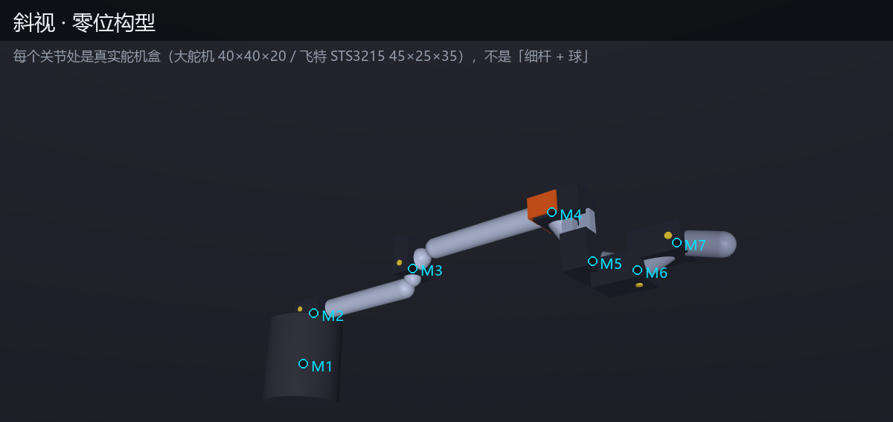
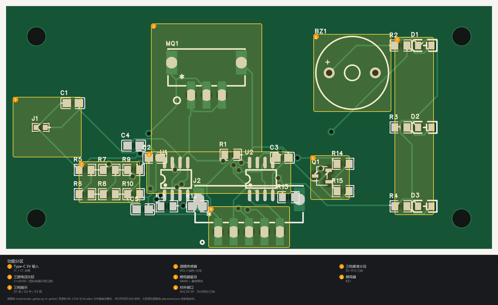
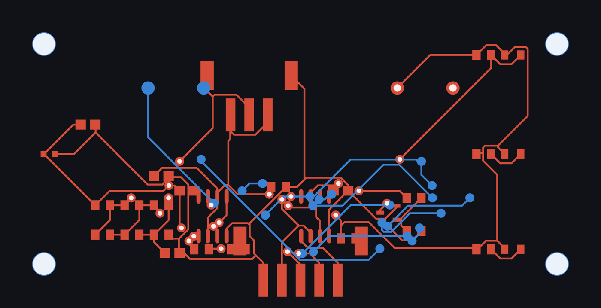

# 李学宇 · Yancy

广东工业大学 · 工业软件多专业融合班（2026 年转入）

> 四个仓，四件事，同一个做法：**每个数字都要能指回一个来源；每条检查都要写清它没查什么。**

---

## 0. 三分钟版

| 仓 | 交付物 / 我做了什么 | 能验的证据 | 没验证的 |
|---|---|---|---|
| [`v12-engine`](https://github.com/GITHUB_USER/v12-engine)<br>几何 | 单文件 `index.html`（≈150 KB，无构建）。全部几何程序化生成：活塞/连杆/曲轴/凸轮/弹簧/链系/歧管，声音也是代码合成 | 活塞位置用精确解而非简谐近似，两式最大差 5.1 mm 可算；面内采样碰撞检查跑 8 个曲轴转角，抓出 4 处真实干涉并修掉；运行时计数从 `__v12.stats` 读 | 功率/扭矩曲线是手写高斯拟合，不对应任何机型；**配气相位与活塞几何没对齐**（见 §2.1）；没量过帧时间 |
| [`arm-mujoco-sim`](https://github.com/GITHUB_USER/arm-mujoco-sim)<br>仿真 | 参数化 MJCF 生成器：`arm_params.py` 唯一数字来源 → `build_mjcf.py` → `arm_real.xml` 产物，附 3 个检查脚本 + 5 份文档 | 计数从编译后的 `MjModel` 读：nbody=11 / njnt=7 / ngeom=28 / nu=7 / 1.656 kg；同机重跑 3 次 md5 一致；胶囊 `fromto` 语义 4 组实测；装配链 23 对：0 断开 | **6 处关键尺寸未确认**；碰撞默认关闭；惯量 7/10 body 硬编码；不给任何碰撞百分比 |
| [`hw-designs`](https://github.com/GITHUB_USER/hw-designs)<br>硬件 | 80×40 mm 酒精检测板（Gerber 预览渲染器 + 网表/摆位/交叉三个检查）+ 24 条目结构件（坐标统一 + 转换链 + 七关节骨架） | 渲染器只依赖 numpy+Pillow，直接解析 RS-274X / Excellon；三层检查各有规则数与结果；9 个派生产物删净重跑逐字节一致（且在干净克隆里验证过）；24 件 STEP 均能被 OpenCascade 读入 | **没打样、没上电、没标定、没打印**；没做铜层连通性比对、无完整 DRC/ERC；**没有精度数字** |
| [`ar-subtitle-ui`](https://github.com/GITHUB_USER/ar-subtitle-ui)<br>界面 | 14 个单文件 HTML + 总览页 + 1 个排版探针、1 个出图脚本。面对面同传：手机上下两屏 + 眼镜端 mockup | `probe_layout.py` 三条自定义判据在 Edge headless（默认视口、虚拟时间推进 4 秒后取样）扫描 14 页 → 0 命中，三条的盲区各自列明；面板宽度由一次未入仓的扫描定到 330 px | **纯浏览器原型**：预设六句对话、模拟状态，没接麦克风/ASR/翻译/AR 硬件；558 px 参数来源未核实 |

**四个仓的共同状态**：没有一块板打过样，没有一台机器上过实机，**我没有亲自做过任何模型的整机测绘**。
机械臂的尺寸是制作者拿卡尺量完转述的（另有六处未确认），不是我自己测的。
下面每一句"通过"，都只到**文件层**或**浏览器层**。

---

## 1. 总览

| 几何（`v12-engine`） | 仿真（`arm-mujoco-sim`） |
|---|---|
|  |  |
| **硬件（`hw-designs`）** | **界面（`ar-subtitle-ui`）** |
|  |  |

这四张不是我截的图，是各仓自己的出图脚本产出的，再由 `tools/make_thumbs.py` 压成缩略图。
源仓提交号记在 §5，改了图就回源仓重跑。

---

## 2. 四个仓

### 2.1 几何 · `v12-engine`

一台 6.5 L、60° V12、DOHC 48 气门的**参数化运动与交互拆解演示**，在浏览器里实时跑。
没有模型文件、贴图、HDRI、音频采样；运行时唯一的第三方依赖是 Three.js r161（CDN 加载，**需要联网**）。

**先钉单位，再谈像不像。** `1 scene unit = 1 cm`，曲轴回转中心为原点，X 轴沿曲轴轴线：

| 项 | 值 | 来源 |
|---|---|---|
| 缸径 × 行程 | 95 × 76.4 mm | 需求规格书 `docs/SPEC.md` |
| 曲轴回转半径 | 38.2 mm | 由行程推出：76.4 / 2 |
| 连杆中心距 | 145 mm | 需求规格书 `docs/SPEC.md` |
| 缸心距 | 102 mm | 需求规格书 `docs/SPEC.md` |
| V 角 | 60° | 需求规格书 `docs/SPEC.md` |
| 点火提前角 | 固定 30° BTDC | **为演示固定取值**，不是 ECU 标定 |

这些是**目标参数**，不是某台量产机的实测数据。钉住单位之后，"看起来像"就不再是标准了 ——
活塞位置按无偏置曲柄连杆几何精确解：

$$s(\theta) = r\cos\delta + \sqrt{L^2 - r^2\sin^2\delta},\qquad \delta = \theta + i\cdot 60° - 30°\sigma$$

$r=3.82$、$L=14.5$（cm），$\theta$ 是曲轴自零位的转角（正向绕 +X），$i\in\{0..5\}$ 是**列内几何序号**
（不是缸号），$\sigma=\pm1$ 分左右列。缸号是另一套映射：`cylId(side,i) = side>0 ? 12-i : i+1`。

**为什么不用简谐近似。** 最常见的偷懒写法把连杆当无限长，两式在上下止点**完全相等**，
所以止点看不出差别。偏差最大在**曲柄与缸轴垂直时（$\delta = 90°/270°$）**——注意这不是
"活塞走到行程几何中点"，两者差着 $\sqrt{L^2-r^2}$ 与 $L$ 的那点距离，本段正在讲精确解与近似的区别，
所以不能混用：

$$\Delta_{max} = L - \sqrt{L^2-r^2} = 14.5-\sqrt{14.5^2-3.82^2}\approx 0.512\ \text{cm}\approx 5.1\ \text{mm}$$

相机推近看单缸四冲程时会露馅，所以老老实实解根号。

**连杆姿态不用"最小旋转"。** `setFromUnitVectors(up, dir)` 会让杆身沿自身轴滚一个角度，
大头孔的轴就歪出曲拐销方向，看上去是拧的。改成显式搭正交基（`+X` 贴住销轴向，
`_rz = _rx × _dir`，行列式 +1），大头环单独 `quaternion.identity()` 只对位不带侧倾。

**碰撞检查抓出的四个真问题**（都已修）。这类干涉截图看不出来 —— 一千多帧里只有少数角度会穿，
穿的往往是遮挡内侧。做法是对每个三角面取面内采样点，变换进被检零件局部坐标做实体包含判定，
跑 8 个曲轴转角。修掉的四个：曲轴里多铺一根贯穿轴心的圆柱（半径 2.9 到销轴只有 3.82，
大头外半径 3.15，必然埋进去）／连杆杆身比大头还宽（同销两根只剩 0.21 间隙）／
大头跟着杆身侧倾 5.9° 导致同销两根"张嘴"互插／活塞裙做成带端面实心圆柱，端面横切活塞冠 0.15。

**规模口径（一次 headless Edge 实测，逐项区分）**：29 个可交互**分组**（`parts` 长度，
不是零件件数 —— `piston` 一个分组里是 12 只活塞）、163 个 Mesh 对象（含 15 个 `InstancedMesh`）、
374 个实例、329,664 三角形（实例提交量）。旧版写的"139 Mesh / 29.8 万面"与代码自报不符，已按实测更正。

**三个必须说清的缺陷**：

1. **配气相位与活塞几何没对齐** —— 气门升程相位取自点火顺序位次，活塞位置取自几何序号，
   两套编号不同。判据不需要选定参考值：自洽的模型里 12 缸的气门峰偏差应是同一个常数，
   实测是 **10 个不同值**（曲轴度）。这是当前最实质的缺陷，复算脚本在子仓 §5.1。
2. **火焰只在透视模式显示** —— 单通道透明排序下，`depthTest:true` 时整机一点火光都没有；
   当前选 `depthTest:false` 画在壳上，代价是某些角度像浮在表面。分层渲染没做。
3. **旧的"控制台 0 报错 / 帧时间 6.1 ms"已撤下** —— 没记录浏览器版本、视口、DPR 和计时方法，
   不可复核。现在由你自己测：`__v12.errs` 是运行至今捕获的异常数组，`__v12.stats` 是计数。

**在线预览**：https://wbapp-0h1wigjufzkz7jzgnjiu93.app.workbuddy.host/?sharecode=5ACYGHLV2H

---

### 2.2 仿真 · `arm-mujoco-sim`

一张手写的 MJCF 不难，难的是**第二次改**。那台机械臂每个关节处是一整颗舵机：
舵机朝向决定关节轴方向，关节轴方向决定铝杆往哪伸，铝杆长度决定下一个舵机放哪。
改一个尺寸，后面 6 个 body 的 `pos` 全要重算。第一版手写的，改到第三个关节就放弃了 ——
因为**改错了看不出来**：MuJoCo 不报错，它只安静地渲染一个差 20 mm、但看起来挺像回事的模型。

所以改成生成器，只有一条规矩：

```
arm_params.py     ← 人改这里（本项目唯一的数字来源）
      ↓
build_mjcf.py     ← 只写逻辑：面朝向→盒尺寸、向量→关节链、板厚→几何近似
      ↓
arm_real.xml      ← 产物，不手改（改了下一次生成就被覆盖）
```

**它会自己核对，而且会喊。** 生成完先打完整配置（`COLLISION_ON` / `backlash` / 是否画桌面 /
是否画舵机盒），免得跑到一半才发现跑的不是同一份配置；然后逐段打「填 r / 生效 r / 长度」，
被夹取的标 `<< L 太短`：

```console
$ python build_mjcf.py
配置：COLLISION_ON=False  backlash=None°  SHOW_TABLE=True  SERVO_GEOM_ON=True
已生成 arm_real.xml  (9.0 KB)
自检：nbody=11  nq=7  nu=7  ngeom=28
段名                   填r      生效r       长度   备注
  L2_upper_b       10.5mm    9.0mm   20.0mm   << L 太短(r 被夹到 0.45L)
```

这一行是这个项目里最贵的一个 bug，**但它的含义常被读错**。三件事要分开：
`L` 是我想要的胶囊外形总长，`d` 是真正传给 MuJoCo 的球心距，`r` 是半径。

- **MuJoCo** 只认 `d` 和 `r`，几何总长 $= d + 2r$，`d` 不能为 0（1 µm 能过，0 报
  `fromto points too close in geom`）。它不知道"我想做多长"。
- **生成器**由 `L` 反解球心，$d = |L - 2r|$。$r < L/2$ 时总长精确等于 `L`。
- **$r > L/2$ 时那两个点换位**，$d$ 仍是正距，但总长变成 $4r - L$。这一步 MuJoCo 不管，
  得生成器自己拦——它现在只报警，没拦。

实测（mujoco 3.14.0）：`L=44, r=10.5` → 端点距 23 mm → 包围盒 **44.000 mm** ✓；
`L=44, r=22` → 端点距 0 → **报错**；`L=20, r=10.5` → 端点距 1 mm（换位）→ **22.000 mm ≠ 20**。
所以 `0.45L` **不是 MuJoCo 的限制**，是生成器自己留的 10% 余量。
第一版静默夹取：轴心距 **43.86 mm** 的腕部段被砍到 **19.74 mm**（$0.45 \times 43.8634$），
碰撞包络被悄悄放大而日志什么都没说。现在夹了就报警 —— **但几何仍然是错的**，
被缩的那一段形状就是不对，这一条还挂着。

**计数全部从编译后的 `MjModel` 读，不是数 XML 行数**：

| 量 | 值 | 口径 |
|---|---|---|
| `nbody` | 11 | **含 `world`**；实体 body 10 个 |
| `njnt` / `nq` / `nu` | 7 / 7 / 7 | 7 个 hinge；7 个位置伺服 |
| `ngeom` | 28 | 桌面1+底板1+舵机舱1+舵机盒6+输出轴6+连杆胶囊8+U型臂3+连接件2 |
| 总质量 | 1.656 kg | 各 body `body_mass` 求和（底座 0.896 kg） |

七个关节是 `M1_yaw / M2_should / M3_elbow / M4_wp / M5_wy / M6_wr / M7_tool`，
**M1–M6 各对应一颗真实舵机盒，M7 只有关节、没有实体外形**（工具安装位）。
9 段连杆里 `L1_base_m2` 长度为 0、半径 0，只承载 M1 关节不建几何，所以画出来的胶囊是 8 个。

**尺寸不是我量的。** 是那台真实机械臂的制作者拿卡尺一项一项量、一句一句报过来的，
`docs/PARAMS.md` 每条都留着原话。这个过程本身也是仓库内容 —— 包括**六处至今未确认**的尺寸
（M2 支点 18.5 vs 10、M6 排布、M6/M7 的 0 边朝向、腕部三段长度、大舵机偏心、M3 斜段角度），
全部列在首屏的表格里。

**这个仓的边界**：尺寸基本就位，但动力学没标定（10 个 body 里 7 个的 `diaginertia` 是硬编码常数；
舵机盒 geom 没给 `mass`，由体积×默认密度推算得约 32 g，而同尺寸真舵机在 60 g 量级），
碰撞默认关闭。即使 `--collision on`，有非零碰撞掩码的也只有 **11 个 geom**（桌面/底板/舵机舱 + 8 个连杆胶囊），
舵机盒、输出轴、U 型臂的 `contype` **和** `conaffinity` 都是 0，且全模型 `npair=0`、`nexclude=0`。
11 个之间有 **45 对**可能互碰——**"11 个"是可碰几何的个数，不是"11 个互相都碰"**。
**所以本仓不给"这台机械臂会撞哪里"这种结论。** 唯一保留的一组数是**参数敏感性对照**，
它不是结论，是用来解释为什么不能给结论：

> 同一个模型，只把 M2 支点从 10 改成 18.5（差 8.5 mm），
> 打开碰撞、每关节在 `jnt_range` 内独立均匀采样 20000 次、seed=0，
> "撞底座"占比从 39.7% 变 34.1%。**改的是模型，不是真机。**

两组数都能用两条命令复现（`build_mjcf.py --collision on --out …` + `scan_collision.py --xml … --n 20000 --seed 0`），
协议、判据、采样分布都打印在输出头部。但因为 8.5 mm 就能让占比动 5 个点，
它只能当"误差放大镜"用，不能当机械臂的属性读。

---

### 2.3 硬件 · `hw-designs`

两块东西：一块 80 × 40 mm 的双面酒精检测板（往小里做），一套 STS3215 舵机关节结构件（往大里做）。

**状态先说**：板**没打样、没上电、没标定**；夹爪**没打印**。下面所有"通过"只到文件层。

**从 Gerber 反画预览图。** `tools/render_gerber.py`（只依赖 numpy + Pillow）直接读
RS-274X 与 Excellon、自己解析、自己光栅化，全程没开 EDA 软件。



*红顶面 / 蓝底面 / 白钻孔 —— 这张图是脚本画的，不是 EDA 截图。*

**它能证明什么**：这个解析器覆盖了本板用到的指令子集（flash / 线段 / 圆弧 / 区域填充 / 孔径宏），
坐标换算（`%FSLAX45Y45%` 的省略前导零、5 位小数）没写错量级 —— 把 `X8000000` 按 5 位小数
读成 80 mm，错一个量级整张图就飘走。**它不能证明**解析器符合完整标准（本板没有的语法它没机会出错），
**更不能证明**这块板的电气设计是对的。它的价值是给我一张能逐层核对的图，且这张图与源文件永远同步。

三个真问题顺手记着：板框层 GKO 只有四条边线，得先把线段首尾串成闭合环才能填充 ——
一开始用 floodfill，9840×5040 画布跑了 2 分 04 秒，改 `draw.polygon` 后 4.6 秒；
合成顺序是绿油盖铜 → 开窗与铜求交 = 露铜显示区 → 丝印盖在油墨上 → 孔洞最后合成。
这是**本预览器的外观合成规则**，不是制造工序，也不模拟材料光学。

**三层检查，各自查什么：**

| 层 | 脚本 | 实际检查的 | 结果 | 没覆盖 |
|---|---|---|---|---|
| 网表 | `build_netlist.py` | 每个引脚归属唯一 / 有无未接网络 / 有无跨网重名 | 15 网络 82 引脚，3 条规则全过 | Gerber 里的铜是否真按这个网表连 —— **没做铜层连通性比对** |
| 摆位 | `place.py` 的 `P` 字典 | 二维本体框越界 / 两两重叠 / 安装孔禁布 / 连接器插入方向 | 30 器件，4 条规则全过 | 本体框是外接矩形，不等于真实封装与三维装配空间 |
| 交叉 | `verify_placement.py` | 摆件坐标表 ↔ EDA 导出坐标，器件参考点是否落在声明本体框内 | 30/30 落框内 | 只是包含关系粗筛，不校旋转角与外廓 |

第三条要说准确：`placement.json` 是我摆件时填的坐标（**意图**），`FlyingProbeTesting.json`
是从 EDA 工程导出的坐标（**另一阶段的表示**）。两者一致说明"从坐标表到 EDA"这一步没走样，
但**不是两套独立测量** —— 共同上游还是我填的那张表。28 个器件**在导出精度与匹配容差内一致**
（mil→mm、格式化到 5 位小数，能显示的最小刻度就是 0.01 µm，所以这**不是物理测量**）；
另两个差 0.5 mm / 1.86 mm，**疑似**封装原点定义不同，没算完，仍标"疑似"。

**确定性重建**：把 9 个派生产物删干净、从输入重跑，**逐字节一致**（`placement.json`、
`netlist.json`、2 个 HTML、5 张 PNG；`circuit-netlist.md`、`P` 字典、`gerber/` 是输入，一个没动）。
这次实验是在 `git clone` 出来的干净目录里做的 —— 克隆、九个哈希对上、删干净、重跑四条命令、
九个哈希仍对上，所以"照 README 能复现"是实测过的。**这里还挖出一个真坑**：两个脚本原来用
`open(path, "w", encoding="utf-8")`，Windows 自动把 `\n` 转 `\r\n`、Linux 不转，
同一个输入在两台机器上产出的字节不同；而 `.gitattributes` 又设了 `eol=lf`，
意味着**从干净克隆出来的文件哈希和本机不一样**。修法是三处写入显式 `newline="\n"`，
现在工作区、index、克隆三处一致。这仍只说明"这套 numpy/Pillow 版本下同输入同输出"，
**不是"纯函数"** —— 手工调到满意为止的参数一样能确定性生成。

**结构件：24 个模型条目，三种"件"。** 之前三种口径混用对不上，现在按子仓的逐件表对账，
**条目数和实物件数是两个数**：

| 来源 | 条目 | 实物件 | 我做了什么 |
|---|---|---|---|
| 厂商舵机与舵机座 | 7 | 7 | 格式转换、归位 |
| Robonine 并行夹爪（CERN-OHL-P-2.0） | 10 | 11 | 格式转换、归位 |
| SO-101 官方夹爪（Apache-2.0） | 2 | 2 | 格式转换、归位 |
| **U 型支架（按 DXF 重建）** | 3 | 3 | **建折弯实体** |
| **铝杆（cadquery 自建）** | 2 | 2 | **建模** |
| 合计 | **24** | **25** | 24 × 2 种格式 = 48 个入仓文件 |

24 → 25 的算式：15 号是整机总成参考、**不计物料**（所以物料条目 23 个），
夹指与齿条两个条目各出 2 件，23 + 2 = 25。

**开源 12 个条目 / 13 件实物，加上厂商 7 件，都不是我的设计** —— 我只做转换和归位，
不冒充作品。自建的 5 件里，3 件 U 支架的**原设计权利不在我手上**（DXF 作者与许可不明），
所以这 3 件不按 MIT 授权。

**这里没有精度数字，而且是故意没有的。** 旧的"外形偏差 ≤ 0.01 mm""`free_edges = 0`"
在全库找不到产出它们的脚本或 CSV，已被撤下。包围盒一致也不代表形状一致。
现在能确认的只有：24 件 STEP 都能被 OpenCascade 读入并给出包围盒（转换脚本跑通的副产品）。

**一个比精度更值得说的事**：数一下面类型就知道，24 件里有 **14 件 STEP 装的其实是网格** ——
`ADVANCED_FACE` 数量恰好等于三角面数且每个面都是 `PLANE`。成因两种：上游只给 STL 的 9 件，
以及我自己建但走了"实体→三角化→OBJ→反写 STEP"的 5 件（反写那一步把干净的 Ø7×Ø3 圆柱变成了
几百个平面小片）。这 14 件能开、能量、能出图，但**圆柱/样条这类解析曲面已经丢了**，只剩平面片 ——
所以不能直接做尺寸驱动修改，通常要重建。这里要说清：STEP 本来就不保存建模特征树，
"没有历史"不是问题；问题是**连解析曲面都没了**。

**坐标统一是本项目的约定，不是软件的规则。** 我采用 Blender Z-up、SolidWorks Y-up，
导入绕 X 轴 −90°：`SW_X = B_X`、`SW_Y = B_Z`、`SW_Z = -B_Y`。换一套素材就要重新对一次。

**骨架数据里有个差点报错的数**：同一套数据能算出四个完全不同的长度 ——
前六段偏移向量长度之和 517.474 mm（之前被写成"零位末端总长"）、全部八段之和 599.821 mm、
基座原点到零位 TCP 直线距离 **442.014 mm**、到 M6 404.367 mm。**差 75.5 mm**，
路径长度当臂展报会让人对尺寸产生错判。运动学"验证"的真实范围也只是两个零位单关节冒烟检查
（M2 +30°、M1 45°，判据 `err < 0.05 mm`）—— 零位时局部轴恰好与世界轴重合，这种测试覆盖不到
局部轴变换问题。

---

### 2.4 界面 · `ar-subtitle-ui`

面对面同传：两个人各自看自己手机的下半屏，手机上半屏给对方看（**要 180° 旋转**），
外加一副 AR 眼镜只留最近 3 句。14 套视觉方案，每套一个单文件 HTML。
字体内嵌 base64，无外链、无构建工具，双击即开。

**这是浏览器里的交互与视觉原型**：使用**预设的六句对话**和**模拟状态**，没有接入麦克风采集、
语种识别、流式 ASR、机器翻译或 AR 硬件。中间的"AR 眼镜视野"是页面里画的 mockup，不是真机投屏。
它回答的是"一个屏幕两端坐两个人的同传界面该长什么样"，不是"同传系统能不能跑"。

**约束先算清楚，再开始好看。** 关键是把"算出来的"和"定下来的"分开：

| 约束 | 这个数是算的还是定的 |
|---|---|
| 眼镜块宽 279 px（558 取半） | 算，但 **558 的来源未核实**（外部提供，无设备型号/视场角/渲染缩放依据） |
| 中文 12.8 px（17 × 0.75）、英文 8 px（12.8 × 0.62） | 算 + 取整 |
| 译文字幕延迟 700 ms 起、中文 55 ms/字、英文 20 ms/字 | **定**（动画参数，不是性能测量） |
| 旧句按视觉行指数衰减 100% → 80% → 收敛 50% | **定**（视觉取舍） |
| 眼镜端只留当前句 + 2 句历史，尺寸 80% / 60% | **定**（信息密度选择，不是视野安全结论） |
| 对方那半边不出现中文，只有英文 | **定**（场景设定） |
| 按语言判断谁在说（中文=我方，英文=对方） | **取巧，不是说话人分离**，语种判定 ≠ 说话人判定 |

**判据可执行，不靠眼睛。** `tools/probe_layout.py` 对 14 个页面跑三条**自定义**判据：
元素 `scrollWidth` 溢出父容器、两个纯文本 rect 垂直与水平同时相交 > 2 px、
`.hint` 内宽度 < 18 px 的视觉行数。运行环境是 Edge `--headless=new`（**未显式设置视口**，
用默认尺寸）+ `--virtual-time-budget=4000` —— **虚拟时间推进 4 秒后取样，这不是"等到动画结束"**。
结果 **0 / 14 命中**。

三条判据各自都有已知盲区，写在同一张表里：溢出判据**主动排除了 `overflow` 不为 visible 的元素**
—— 而内容裁切恰好发生在这些元素里；交叠判据只比文本节点，不覆盖绝对定位层与伪元素；
碎片判据把行宽当碎片判据，测不出"被折断的短语"这种语义碎片。
所以结论只能是"这三条自定义检查在这个环境下没报警"，**不是"页面没有问题"**。

**两个"以为是 bug 其实不是"的例子，以及它们的正确结论：**

- 截图里"英文行被中文压住"。量了 6 行的 `offsetHeight / scrollHeight / line-height / margin`
  全部一致 —— 那是飞字本身横穿过去、70% 透明压出来的观感，布局没塌。
  但**用户看得见遮挡就是真问题**，所以结论是"布局没错，观感要改"，不是"不是 bug"。
- 说明面板用点阵字体时字发糊。第一版探针报 20 处"重叠"，全是父元素 rect 与子文本 rect
  被重复计数（父子必然包含）；剔掉容器 rect 只比纯文本 rect，真重叠 0 处。
  真原因是全局一条 `.devbar{font-family:var(--sf)!important}` 把点阵字体套到 11.5 / 12 / 14
  三档字号的面板上 —— 12 px 是这套字体的原生设计尺寸，另外两档在**本机浏览器 + DPR 1** 下观察到模糊。

面板宽度是在 268–356 px 的扫描范围里按三条规则选的：语义碎片行消失、窄行 0、总行数 ≤ 9。

| 面板宽 | 行数 | 窄行（< 40px） |
|---|---|---|
| 268 px | 12 | 0（但有语义碎片行） |
| 290–312 px | 11 | 2 |
| 320 px | 10 | 1 |
| **330 px** | **9** | **0** |
| 340–356 px | 9 | 0 |

**330 px 是同时满足三条的最小已测宽度**；340–356 px 仍是 9 行 0 窄行，没有再降，所以取 330。
（这张表来自一次**未入仓**的扫描，仓内只有另一口径的 `probe_layout.py`，所以它是决策记录，
不是可复现产物；"更大的宽度也没收益"这句话**没有测过**，不能推广。）

有一套方案（E · 构成主义斜轴）被判定放弃，理由写在 `_skipped/` 里：斜轴 −5° 会划过对方那栏的
最后一行字，且红块压住深色正文，合成后对比度只有约 2.1:1。**放弃也要留记录**，否则下次会有人
重新捡起来再踩一遍。

---

## 3. 四个仓共用的四条做法

不是技术，是习惯。写完四个仓回头才发现的：

1. **一个数字只想定义一次。** 能集中就集中：`arm_params.py`、`P` 字典、`1 unit = 1 cm`。
   集中只减少"同一件事写两遍、改了一处漏另一处"，**它不保证那个数是真值** ——
   558 px 的来源仍未核实，机械臂还有六处尺寸没确认。自检也只在已编码的规则内报警，
   判断不了外部参数对不对。
2. **产物不手改。** 生成的 XML、渲染的 PNG、压好的缩略图，都是脚本的输出。
   手改产物 = 埋一颗下一次重建就爆的雷。
3. **判据要能跑，而且要说清它没查什么。** "看起来对"不算；但"脚本跑过了"也不算 ——
   得写清这条规则覆盖到哪里，否则检查本身会变成新的错觉。四个仓的证据表都带"没检查什么"那一列。
4. **坑写进文档。** 静默夹取的胶囊半径、`!important` 泄漏、floodfill 跑 2 分钟、
   路径长度当臂展报、12 缸配气相位偏差该是常数却是 10 个值 —— 这些不是丢人的东西，
   是这份工作的成本清单。

---

## 4. 这份材料被独立评审过一遍

五份 README 交给模型池里的 **GPT-6.1 Sol**，以工业软件方向面试官视角专门挑错，
一共提出 **130 余条**意见。逐条处置写在 [`REVIEW.md`](REVIEW.md)：哪些接受、哪些只接受一半、
哪些不接受以及为什么。三个系统性问题是这轮修订的主线：把"一致性检查"写成"正确性证明"、
关键边界放得太晚、术语误用（"流片"、"眼镜视野实测"、"装配精度"）。

这一轮之后，`arm-mujoco-sim` 又单独过了一轮 23 条评审，做了更彻底的重写：
把碰撞段落从"结论"降级为"参数敏感性对照"、把六处未确认尺寸前置到首屏、
用实测数据改写"胶囊半径不能超过杆长一半"这个错误解释（它从来不是 MuJoCo 的限制）。

**评审也不是没有偏差**：它按论文标准审求职材料，所以对叙事性的批评偏多；它没看过代码，
只能凭 README 判断，所以能指出"没写"，不能指出"写错了"。反过来说这正是它有用的地方 ——
一个没看过代码的读者读出来的印象，就是面试官读出来的印象。

---

## 5. 复现与发布前检查

这个仓只放总览，源码在四个仓里。

```bash
python tools/make_thumbs.py    # 从四个兄弟仓取代表图压成缩略图（本仓不放原件）
```

缩略图对应的**取图时源仓提交号**（改了图就回源仓重跑出图脚本，再跑上面这条）：

| 缩略图 | 源仓 | 取图时的提交 |
|---|---|---|
| `shots/01-v12.png` | `v12-engine` | `b4f0e9b` |
| `shots/02-arm.png` | `arm-mujoco-sim` | `9fa16ab` |
| `shots/03-pcb.png`、`shots/04-copper.png` | `hw-designs` | `2ace3dc` |
| `shots/05-ui.png` | `ar-subtitle-ui` | `692ce32` |

子仓后续如果只改了文档、没动 `shots/`，缩略图仍然对得上。想确认就查这一条：

```bash
git -C ../ar-subtitle-ui log --oneline 692ce32..HEAD -- shots/   # 无输出 = 图没变
```

**发布前必做**（一次性，做完应该残留 0 处）。用脚本，不要用 `grep`：

```bash
python tools/check_links.py                    # 退出码 0 = 干净，1 = 还有占位符
python tools/check_links.py --fix --user <用户名>
```

**为什么不能写一行 `grep`**：占位符那个串本身会出现在检查命令里，`grep` 一定命中它自己，
于是"grep 不到"这个判据永远不成立。`tools/check_links.py` 把占位符拆成 `PLACE_A + PLACE_B`
拼出来，源码里不存在那个完整的串，所以它不自指；它也只扫 `.md`、只改**链接目标**，
不动正文里对仓名的引用。

**这段同步没有自动化。** 图片是指定源仓提交的**快照**，脚本只保证"生成时按输入画对"，
不会让已提交的缩略图随子仓自动更新；源图变了仍需手动重跑，当前没有过期检测。
文字里的数字同理：本仓没有 CI、没有跨仓链接校验，子仓改了数字，这里要手动跟一遍。
记录取图提交号是为了**可追溯**，不是自动同步。

---

## 许可

原则一条：**不是我的设计就写明不是我的**，并且写清"现在拿什么权利在分发"，
不写"待核实"来把状态拖到发布之后。逐条现状（明细在 `hw-designs` 的子仓里）：

| 内容 | 现在的状态 |
|---|---|
| 各仓脚本与文档 | MIT |
| Robonine 并行夹爪 10 条 / 11 件 | **CERN-OHL-P-2.0**，引其 `HARDWARE-LICENSE.txt`（不是仓库根 LICENSE） |
| SO-101 官方夹爪 2 件 | **Apache-2.0** |
| 厂商舵机与舵机座 7 件 | **未声明许可** —— 本仓不主张任何权利；权利人提出异议即撤下，改为官方链接 + 处理脚本 |
| U 型支架 3 件（按 DXF 重建） | **原 DXF 许可不明** —— 重建与格式转换都不产生新的授权，所以这 3 件**不进公开仓**，等权利确认 |
| 铝杆 2 件（cadquery 自建） | MIT |

最后一条是这次理清的：**"不按 MIT 授权"不等于"有权公开分发"**。重新建模、换格式，
都不消除原设计的权利。所以这 3 件在公开版里是缺的 —— 与其附一句免责声明，不如先不放。

数据手册版权归各厂商，仅作设计依据引用。
